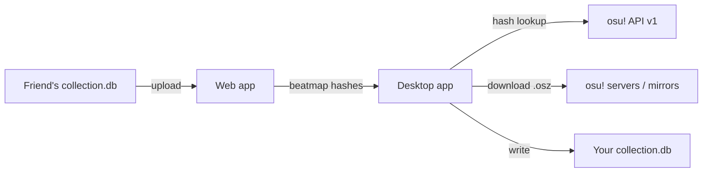

# osu! Collection Hub: Desktop

Share osu! beatmap collections with friends in a couple of clicks.

My friends and I kept trading collections by sending `collection.db` files back and forth, then hunting down every missing map by hand. osu! Collection Hub fixes that. A friend uploads their collections to the [web app](https://github.com/ryelae/OsuCollectorWebApp), and this desktop app shows you which maps you're missing, downloads them, and writes the collection straight into your local `collection.db`.

Built with Electron, React, and TypeScript.

<!-- Screenshot: add a screenshot or GIF of the import flow here, e.g.  -->

## What it does

- Connects to a hosted Collection Hub web app (run by you or a friend)
- Browses uploaded collections by user, with search
- Compares each collection against your Songs folder and skips maps you already have
- Resolves beatmap hashes to beatmapset IDs through the osu! API, with a local cache so repeat lookups are instant
- Downloads missing `.osz` files from osu!'s official servers, falling back to public mirrors if that fails
- Writes the imported collection into your local `collection.db`

## How it works



A few of the interesting parts:

- **Binary format parsing.** osu! stores collections in a custom binary format (ULEB128 length prefixed strings, little endian ints). The app reads and writes it directly so imported collections show up in osu! like any other.
- **Hash resolution.** Collections only store MD5 hashes of each difficulty, so every hash has to be looked up to find which beatmapset to download. Lookups run in small concurrent batches to stay within API limits, and results are cached on disk.
- **Download fallbacks.** Maps download from osu!'s official servers when you're logged in through OAuth. If that fails, the app tries nerinyan.moe, osu.direct, and beatconnect in order.
- **Path detection.** Your osu! install is found through the Windows registry, so most people never have to browse for their Songs folder.

## Requirements

- Windows (osu! stable is Windows only)
- Access to a running [osu! Collection Hub](https://github.com/ryelae/OsuCollectorWebApp) instance (URL and password from whoever hosts it)
- An [osu! API v1 key](https://osu.ppy.sh/p/api) (free, takes about a minute)
- Optional but recommended: an osu! OAuth application for official downloads (free, takes about two minutes, see setup below)

## First-time setup

### 1. Connect to the web app

Open **Settings → Web App Connection**. Enter the URL and shared password from whoever is hosting the web app, then click **Test Connection**.

### 2. Get an osu! API v1 key

1. Go to [osu.ppy.sh/p/api](https://osu.ppy.sh/p/api) and log in
2. Fill in any application name and URL (e.g. `http://localhost`)
3. Copy the key and paste it into **Settings → osu! API Key**

### 3. Set up osu! OAuth (for official downloads)

This lets the app download maps directly from osu!'s servers. Without it, the app uses public mirrors.

1. Go to [osu.ppy.sh/home/account/edit](https://osu.ppy.sh/home/account/edit) and scroll down to **OAuth Applications**
2. Click **New OAuth Application**
3. Give it any name (e.g. `osu hub desktop`)
4. Set the **Callback URL** to exactly: `http://127.0.0.1/osu-hub-callback`
5. Click **Register**
6. Copy the **Client ID** and **Client Secret** into **Settings → osu! Account**
7. Click **Log in to osu!**. A browser window opens for you to approve access, then closes on its own.

### 4. Set your Songs folder

In **Settings → osu! Songs Folder**, click **Auto-detect**. If it doesn't find it, click **Browse** and pick your osu! Songs folder manually (usually `C:\Users\<you>\AppData\Local\osu!\Songs`).

### 5. Import a collection

1. Go to the **Import Collections** tab
2. Collections load automatically. Search by uploader name or collection name to find what you want.
3. Click a collection to see which maps you're missing
4. Click **Download & Import**. Missing beatmapsets download and the collection is added to your `collection.db`.
5. Press **F5** in osu! to scan for new maps, then fully restart osu! to see the new collection in your list

## Running from source

```bash
npm install
npm run dev
```

Typecheck with:

```bash
npm run typecheck
```

## Building a portable executable

```bash
npm run package
```

Output: `dist/osu! Collection Hub <version>.exe`

## Tech stack

| Layer               | Technology                                                             |
| ------------------- | ---------------------------------------------------------------------- |
| Framework           | Electron 31                                                            |
| Build tool          | electron-vite                                                          |
| Frontend            | React 18, TypeScript                                                   |
| Settings and cache  | electron-store                                                         |
| osu! path detection | Windows registry via winreg                                            |
| Downloads           | osu! API v2 (OAuth), nerinyan.moe / osu.direct / beatconnect fallbacks |

## License

MIT. See [LICENSE](LICENSE).
